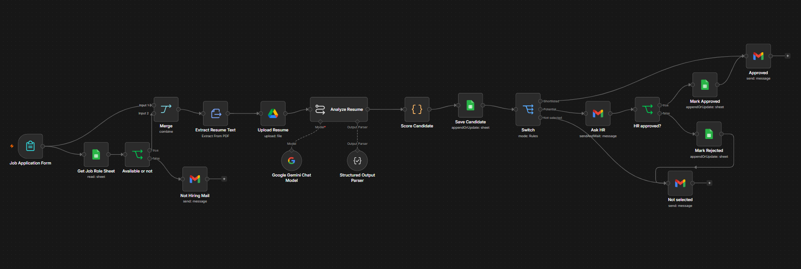

# AI Resume Screener (n8n + Gemini)

An end-to-end hiring workflow built in **n8n**. Candidates apply through a form, their resume is read and
scored by AI against the role's requirements, and every applicant automatically gets the right outcome:
shortlisted, sent to HR for review, or politely rejected with personalised tips to improve.



## How it works

```
Job Application Form (name, email, phone, role, resume PDF)
   ↓
Get Job Role (Google Sheets) → Is the role open?
   ├── No  → "We're not hiring for this role" email
   └── Yes ↓
Merge (form + resume file + role rules)
   ↓
Extract Resume Text (PDF → text) → Upload Resume (Google Drive)
   ↓
Analyze Resume (Gemini + Structured Output Parser)
   → matched keywords, work history with dates, summary, 3 tips
   ↓
Score Candidate (Code) → score 0–100 + verdict
   ↓
Save Candidate (Google Sheets)
   ↓
Switch on verdict
   ├── 85–100  Shortlisted   → "Your resume has been shortlisted" email
   ├── 80–84   Potential     → HR gets an email with Approve / Reject buttons (workflow waits)
   │                              ├── Approve → sheet updated + shortlisted email
   │                              └── Reject  → sheet updated + rejection email with tips
   └── 0–79    Not selected  → rejection email with 3 AI improvement tips
```

## Scoring

The AI only **reads and extracts**. The score is calculated in a Code node with a fixed formula, so the same
resume always gets the same score and every number can be explained.

| Part | Weight | How it's calculated |
|---|---|---|
| Must-have keywords | 50 | Matched ÷ total must-have keywords |
| Nice-to-have keywords | 25 | Matched ÷ total nice-to-have keywords |
| Experience | 25 | Years of experience ÷ role minimum (capped at full marks) |

**Experience** is worked out from the job dates the AI extracts: "present" counts as today, overlapping jobs
are merged so they aren't counted twice, and internships count at half weight.

Keyword matching understands variants (for example "React.js" = "React", "RESTful APIs" = "REST API").

## Fairness

The AI prompt tells the model to ignore name, gender, age, nationality, photos and college prestige, and to
judge only skills and work experience. Borderline candidates (80–84) are always reviewed by a person.

## n8n features used

- **Form Trigger** with PDF file upload
- **Google Sheets**: role rules lookup, candidate log (append or update by candidate ID)
- **If** and **Switch** for routing, **Merge** to keep the uploaded file alongside the role data
- **Extract from File** to read PDF text without any code
- **Basic LLM Chain + Google Gemini** (temperature 0) with a **Structured Output Parser**
- **Code** node (JavaScript) for experience calculation, scoring and the candidate ID
- **Google Drive** to store each resume in a per-role folder
- **Gmail** emails and **send-and-wait approval** (human-in-the-loop)

## Setup

1. Import `workflow.json` into n8n (**⋯ → Import from File**).
2. Connect your own credentials: Google Sheets, Google Drive, Gmail and Google Gemini.
3. Create a Google Sheet with two tabs:

   **Job Roles**

   | role | Vacancy | type | must_have | nice_to_have | min_experience | drive_folder_id |
   |---|---|---|---|---|---|---|
   | Full Stack Developer | Available | Technical | React, Node.js, JavaScript, SQL, REST API | TypeScript, AWS, Docker, Git, MongoDB | 2 | *(Drive folder ID)* |

   **Candidates**

   `candidate_id, applied_at, name, email, phone, role, score, verdict, experience_years, matched_must_have,
   missing_must_have, matched_nice, ai_summary, tips, resume_link, hr_decision`

4. Replace `YOUR_SPREADSHEET_ID` in the Google Sheets nodes with your sheet (or reselect it from the list).
5. Create a Google Drive folder for each role and paste its ID into `drive_folder_id`.
6. In **Ask HR**, change `hr@example.com` to the HR reviewer's email.
7. Make sure the **Role** options in the form match the `role` column exactly.
8. Set the workflow timezone in **Settings**.

## Adding a new role

Add a row to **Job Roles** (with keywords, minimum experience and a Drive folder ID) and add the same role
name to the form's Role dropdown. No other changes are needed. Set **Vacancy** to anything other than
`Available` to stop accepting applications for a role.
